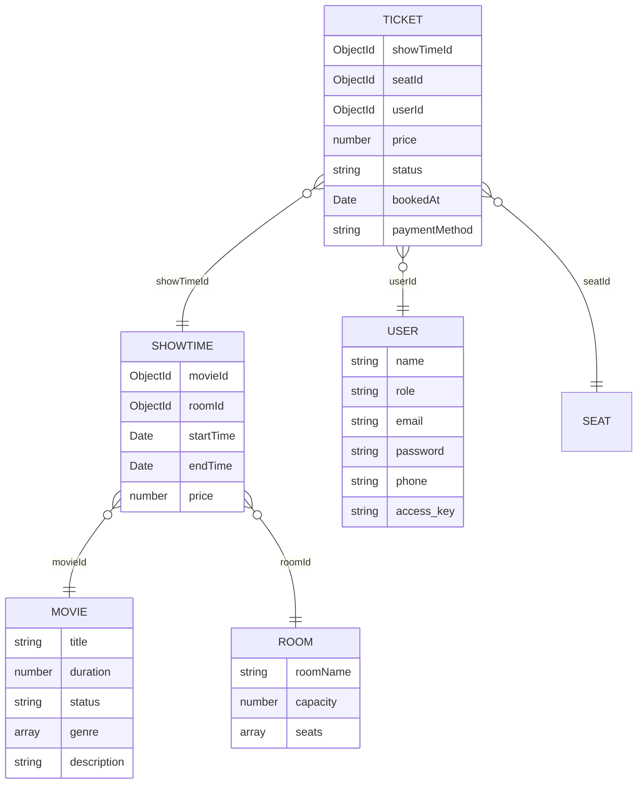

# BAN DO LIEN KET DU LIEU & KIEN TRUC HE THONG (SDN302)

> File nay duoc tu dong phan tich va sinh boi khoi-tao.js dua tren du lieu mau tu `D:\workspace\Bai_tap_tai-lieu_FPTU\Workplace-FPTU\SDN302\thi-thu\sdn-pe\SDN302 - SU 26 - TRIAL1 - Paper 2\data`.

---

## 1. So do thuc the lien ket (ERD)




---

## 2. Bang ma tran quan he (Foreign Keys)

| Collection goc | Truong khoa ngoai (Field) | Tham chieu Model | Collection dich | Quan he | Ghi chu |
| :--- | :--- | :--- | :--- | :--- | :--- |
| **showtimes** | `movieId` | **Movie** | `movies` | N - 1 | Khoa ngoai truc tiep |
| **showtimes** | `roomId` | **Room** | `rooms` | N - 1 | Khoa ngoai truc tiep |
| **tickets** | `showTimeId` | **ShowTime** | `showtimes` | N - 1 | Khoa ngoai truc tiep |
| **tickets** | `seatId` | **Seat** | `seats` | N - 1 | Khoa ngoai truc tiep |
| **tickets** | `userId` | **User** | `users` | N - 1 | Khoa ngoai truc tiep |


---

## 3. Danh muc API CRUD mau

| Method | Endpoint | Controller | Route | Model |
| :---: | :--- | :--- | :--- | :--- |
| `GET` | `/api/movies` | `movie.controller.js` | `movie.route.js` | `movie.model.js` |
| `GET` | `/api/movies/:id` | `movie.controller.js` | `movie.route.js` | `movie.model.js` |
| `POST` | `/api/movies` | `movie.controller.js` | `movie.route.js` | `movie.model.js` |
| `PUT` | `/api/movies/:id` | `movie.controller.js` | `movie.route.js` | `movie.model.js` |
| `DELETE` | `/api/movies/:id` | `movie.controller.js` | `movie.route.js` | `movie.model.js` |
| `GET` | `/api/rooms` | `room.controller.js` | `room.route.js` | `room.model.js` |
| `GET` | `/api/rooms/:id` | `room.controller.js` | `room.route.js` | `room.model.js` |
| `POST` | `/api/rooms` | `room.controller.js` | `room.route.js` | `room.model.js` |
| `PUT` | `/api/rooms/:id` | `room.controller.js` | `room.route.js` | `room.model.js` |
| `DELETE` | `/api/rooms/:id` | `room.controller.js` | `room.route.js` | `room.model.js` |
| `GET` | `/api/showtimes` | `showtime.controller.js` | `showtime.route.js` | `showtime.model.js` |
| `GET` | `/api/showtimes/:id` | `showtime.controller.js` | `showtime.route.js` | `showtime.model.js` |
| `POST` | `/api/showtimes` | `showtime.controller.js` | `showtime.route.js` | `showtime.model.js` |
| `PUT` | `/api/showtimes/:id` | `showtime.controller.js` | `showtime.route.js` | `showtime.model.js` |
| `DELETE` | `/api/showtimes/:id` | `showtime.controller.js` | `showtime.route.js` | `showtime.model.js` |
| `GET` | `/api/tickets` | `ticket.controller.js` | `ticket.route.js` | `ticket.model.js` |
| `GET` | `/api/tickets/:id` | `ticket.controller.js` | `ticket.route.js` | `ticket.model.js` |
| `POST` | `/api/tickets` | `ticket.controller.js` | `ticket.route.js` | `ticket.model.js` |
| `PUT` | `/api/tickets/:id` | `ticket.controller.js` | `ticket.route.js` | `ticket.model.js` |
| `DELETE` | `/api/tickets/:id` | `ticket.controller.js` | `ticket.route.js` | `ticket.model.js` |
| `GET` | `/api/users` | `user.controller.js` | `user.route.js` | `user.model.js` |
| `GET` | `/api/users/:id` | `user.controller.js` | `user.route.js` | `user.model.js` |
| `POST` | `/api/users` | `user.controller.js` | `user.route.js` | `user.model.js` |
| `PUT` | `/api/users/:id` | `user.controller.js` | `user.route.js` | `user.model.js` |
| `DELETE` | `/api/users/:id` | `user.controller.js` | `user.route.js` | `user.model.js` |


---

## 4. Chi tiet cau truc tung Collection


### Collection: `movies` (Model: `Movie`)
- **So luong ban ghi mau**: 6 documents
- **API Endpoint**: `http://localhost:9999/api/movies`

| Truong (Field) | Kieu du lieu (Type) | Bat buoc (Required) | Tham chieu (Ref) |
| :--- | :--- | :---: | :--- |
| `title` | `string` | Co | - |
| `duration` | `number` | Co | - |
| `status` | `string` | Co | - |
| `genre` | `array` | Co | - |
| `description` | `string` | Co | - |

### Collection: `rooms` (Model: `Room`)
- **So luong ban ghi mau**: 5 documents
- **API Endpoint**: `http://localhost:9999/api/rooms`

| Truong (Field) | Kieu du lieu (Type) | Bat buoc (Required) | Tham chieu (Ref) |
| :--- | :--- | :---: | :--- |
| `roomName` | `string` | Co | - |
| `capacity` | `number` | Co | - |
| `seats` | `array` | Co | - |

### Collection: `showtimes` (Model: `Showtime`)
- **So luong ban ghi mau**: 8 documents
- **API Endpoint**: `http://localhost:9999/api/showtimes`

| Truong (Field) | Kieu du lieu (Type) | Bat buoc (Required) | Tham chieu (Ref) |
| :--- | :--- | :---: | :--- |
| `movieId` | `ObjectId` | Co | `ref: 'Movie'` |
| `roomId` | `ObjectId` | Co | `ref: 'Room'` |
| `startTime` | `Date` | Co | - |
| `endTime` | `Date` | Co | - |
| `price` | `number` | Co | - |

### Collection: `tickets` (Model: `Ticket`)
- **So luong ban ghi mau**: 8 documents
- **API Endpoint**: `http://localhost:9999/api/tickets`

| Truong (Field) | Kieu du lieu (Type) | Bat buoc (Required) | Tham chieu (Ref) |
| :--- | :--- | :---: | :--- |
| `showTimeId` | `ObjectId` | Co | `ref: 'ShowTime'` |
| `seatId` | `ObjectId` | Co | `ref: 'Seat'` |
| `userId` | `ObjectId` | Co | `ref: 'User'` |
| `price` | `number` | Co | - |
| `status` | `string` | Co | - |
| `bookedAt` | `Date` | Co | - |
| `paymentMethod` | `string` | Co | - |

### Collection: `users` (Model: `User`)
- **So luong ban ghi mau**: 6 documents
- **API Endpoint**: `http://localhost:9999/api/users`

| Truong (Field) | Kieu du lieu (Type) | Bat buoc (Required) | Tham chieu (Ref) |
| :--- | :--- | :---: | :--- |
| `name` | `string` | Co | - |
| `role` | `string` | Co | - |
| `email` | `string` | Co | - |
| `password` | `string` | Co | - |
| `phone` | `string` | Co | - |
| `access_key` | `string` | Co | - |


---

## 5. Cu phap Mongoose tham khao

### Truy van kem Populate:
```javascript
const data = await Model.find().populate('studentId');

const data = await Class.findById(classId).populate('enrollments.studentId');

const data = await Attendance.find({ studentId }).populate({
  path: 'classId',
  populate: { path: 'subjectId' }
});
```

### Kiem tra ObjectId hop le:
```javascript
const mongoose = require('mongoose');
if (!mongoose.Types.ObjectId.isValid(id)) {
  return res.status(400).json({ error: `Invalid ID: ${id}` });
}
```
