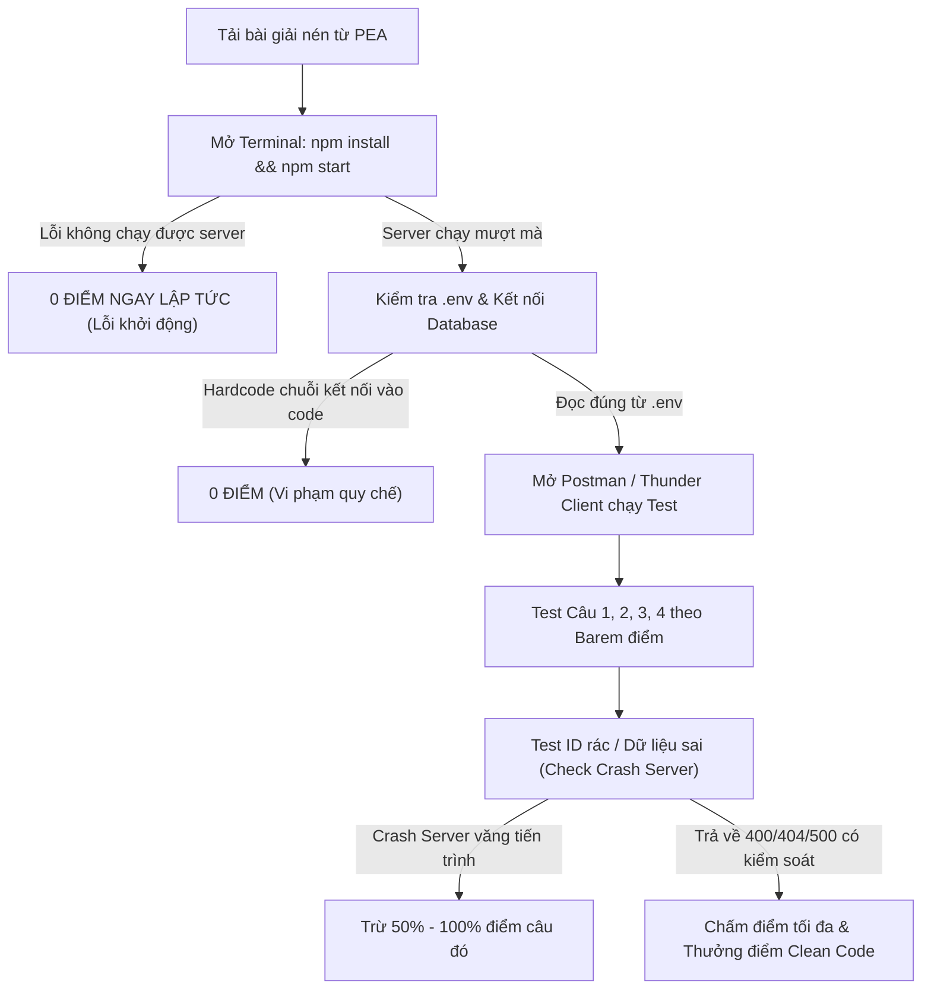

# CHIẾN LƯỢC THI THỰC HÀNH SDN302 TỐI ƯU (ĐẠT TỪ 4.0 ĐẾN 10.0 ĐIỂM)
> **Dành riêng cho sinh viên FPT University - Môn SDN302 (Server-side JavaScript / Node.js & MongoDB)**  
> **Hình thức chấm**: Giảng viên chấm bài trực tiếp (Human Grader), KHÔNG PHẢI máy chấm tự động.

---

## PHẦN 1. HIỂU RÕ TÂM LÝ & QUY TRÌNH CHẤM BÀI CỦA GIẢNG VIÊN

Khi chấm thi môn SDN302, giảng viên phải chấm hàng chục bài thi trong thời gian ngắn. Quy trình chuẩn của giảng viên như sau:



### Các "Án Tử" Dẫn Đến 0 Điểm Cần Tránh Bằng Mọi Giá:
1. **Hardcode chuỗi kết nối MongoDB hoặc Port**:
   - Quy chế ghi rõ: *"Connection string must be read from environment variable (.env)"*. Nếu viết thẳng `mongodb://127.0.0.1:27017` trong code mà không dùng `process.env.MONGO_URI` $\rightarrow$ **0 ĐIỂM TOÀN BÀI**.
2. **Server bị Crash khi chạy hoặc test**:
   - Nếu giảng viên gửi một ID không tồn tại hoặc chuỗi bậy bạ mà server văng lỗi `CastError` và chết luôn tiến trình node $\rightarrow$ Giảng viên phải bật lại server, họ sẽ rất bực mình và đánh rớt ngay câu đó.
3. **Quên xóa `node_modules` trước khi nộp lên PEA Client**:
   - Dung lượng vượt quá giới hạn nộp bài của phần mềm PEA, hoặc timeout khi upload $\rightarrow$ Mất bài thi.

---

## PHẦN 2. CHIẾN THUẬT PHÂN BỔ 85 PHÚT PHÒNG THI

| Giai đoạn | Thời gian | Mục tiêu trọng tâm | Điểm số tích lũy |
| :--- | :--- | :--- | :--- |
| **Giai đoạn 1** | 00 – 10 phút | Khởi tạo dự án, nạp DB, sinh Model, kiểm tra .env | Chuẩn bị nền tảng |
| **Giai đoạn 2** | 10 – 30 phút | **ĂN CHẮC 4.0 - 5.0 ĐIỂM (CHẮC CHẮN QUA MÔN)** | **4.0 – 5.0 Điểm** |
| **Giai đoạn 3** | 30 – 65 phút | Hoàn thành câu Thống kê & Nghiệp vụ khó (Bulk/Upsert) | **7.5 – 10.0 Điểm** |
| **Giai đoạn 4** | 65 – 85 phút | Test chống crash, dọn dẹp, xóa `node_modules`, nộp PEA | **Chốt điểm tối đa** |

---

## PHẦN 3. HƯỚNG DẪN CHI TIẾT TỪNG BƯỚC

### BƯỚC 1: 10 PHÚT ĐẦU – SETUP NỀN TẢNG (CHỐNG LIỆT)
1. **Giải nén đề và mở VS Code**:
   - Mở thư mục bài thi được cung cấp.
2. **Kiểm tra file `.env`**:
   - Luôn đảm bảo có các biến:
     ```env
     PORT=9999
     MONGO_URI=mongodb://127.0.0.1:27017/<Tên_DB_Đề_Yêu_Cầu>
     ```
   - *Lưu ý*: Dùng `127.0.0.1` thay vì `localhost` để tránh lỗi DNS trên Node.js v18+.
3. **Nạp dữ liệu vào MongoDB bằng `import-data.js`**:
   - Mở terminal, chạy lệnh:
     ```bash
     node import-data.js ./material_0
     ```
   - Mở MongoDB Compass kiểm tra: Đủ collections, đủ số lượng documents. (Mất đúng 5 giây).
4. **Sinh Models tự động bằng `generate-models.js`**:
   - Chạy lệnh:
     ```bash
     node generate-models.js ./material_0 ./models
     ```
   - Mở các model kiểm tra: Trường `ref` đã trỏ đúng tên Model chưa, `enum` đã đủ chưa.
5. **Kiểm tra `server.js`**:
   - Đảm bảo đã có: `app.use(express.json())`, `app.use(cors())`.
   - Chạy `npm start` hoặc `node server.js` kiểm tra cổng log ra đúng `Server running on port 9999`.

---

### BƯỚC 2: 20 PHÚT TIẾP THEO – LẤY CHẮC CHẮN $\ge 4.0$ ĐIỂM (PASS MÔN)

> [!TIP]
> **Quy tắc vàng**: Không bao giờ làm câu khó trước! Hãy quét ngay 2 câu đọc dữ liệu (GET) dễ nhất trong đề bài để đạt ngay 4.0 điểm qua môn.

#### 1. Dạng câu GET danh sách có lọc (Thường là Câu 1 - 1.5 đến 2.0 điểm):
- Ví dụ: `GET /api/classes/:classId/students?status=enrolled`
- Các bước làm:
  1. Validate ID:
     ```javascript
     if (!mongoose.Types.ObjectId.isValid(classId)) {
       return res.status(400).json({ error: "Invalid class ID format" });
     }
     ```
  2. Tìm entity cha:
     ```javascript
     const cls = await Class.findById(classId);
     if (!cls) return res.status(404).json({ error: "Class not found" });
     ```
  3. Lọc mảng sub-document:
     ```javascript
     const enrolledStudents = cls.students.filter(s => s.status === status);
     const studentIds = enrolledStudents.map(s => s.studentId);
     const students = await Student.find({ _id: { $in: studentIds } });
     ```
  4. Trả về đúng format đề yêu cầu (đổi `_id` thành `id` nếu đề yêu cầu):
     ```javascript
     res.status(200).json(students.map(s => ({
       id: s._id,
       studentCode: s.studentCode,
       fullName: s.fullName,
       email: s.email
     })));
     ```

#### 2. Dạng câu GET theo quan hệ kèm Populate (Thường là Câu 3 - 2.5 điểm):
- Ví dụ: `GET /api/students/:studentId/attendances`
- Mẫu code thần tốc:
  ```javascript
  const attendances = await Attendance.find({ studentId })
    .populate('classId', 'className')
    .populate({
      path: 'classId',
      populate: { path: 'subjectId', select: 'name' }
    })
    .sort({ date: -1 });

  res.status(200).json(attendances.map(a => ({
    id: a._id,
    className: a.classId ? a.classId.className : null,
    subjectName: (a.classId && a.classId.subjectId) ? a.classId.subjectId.name : null,
    date: a.date,
    status: a.status
  })));
  ```
👉 **Đến đây bạn đã có 4.0 điểm trong tay. Tâm lý cực kỳ thoải mái để làm tiếp.**

---

### BƯỚC 3: 35 PHÚT TIẾP THEO – CHINH PHỤC ĐIỂM 8.0 - 10.0

#### 1. Xử lý câu Thống kê / Tính toán (Thường là Câu 2 - 2.5 điểm):
- Công thức: Lấy danh sách đối tượng cần tính $\rightarrow$ Chạy vòng lặp hoặc Aggregate đếm.
- Mẫu xử lý bằng vòng lặp (dễ hiểu, không sợ sai cú pháp Aggregation):
  ```javascript
  const result = [];
  for (const s of enrolledStudents) {
    const totalSessions = await Attendance.countDocuments({ classId, studentId: s.studentId });
    const present = await Attendance.countDocuments({ classId, studentId: s.studentId, status: 'PRESENT' });
    const absent = totalSessions - present;
    const rate = totalSessions > 0 ? (present / totalSessions) * 100 : 0;

    result.push({
      studentCode: s.studentInfo.studentCode,
      fullName: s.studentInfo.fullName,
      totalSessions,
      present,
      absent,
      attendanceRate: Math.round(rate * 10) / 10,
      warning: rate < 80 // Gắn cờ cảnh báo nếu < 80%
    });
  }
  return res.status(200).json(result);
  ```

#### 2. Xử lý câu Ghi dữ liệu / Bulk Upsert (Thường là Câu 4 - 3.5 điểm):
- Đây là câu phân loại sinh viên giỏi. Giảng viên sẽ test các trường hợp sau:
  1. **Validation 1**: Ngày tương lai $\rightarrow$ `new Date(date) > new Date()` $\rightarrow$ Trả về `400`.
  2. **Validation 2**: Thiếu sinh viên của lớp $\rightarrow$ So sánh mảng nộp lên với danh sách `enrolled` của lớp $\rightarrow$ Trả về `400`.
  3. **Validation 3**: Gửi sinh viên lạ không thuộc lớp $\rightarrow$ Trả về `400`.
  4. **Nghiệp vụ Upsert**:
     ```javascript
     let updatedCount = 0;
     for (const record of records) {
       const existing = await Attendance.findOne({ classId, studentId: record.studentId, date: targetDate });
       if (existing) {
         existing.status = record.status;
         await existing.save();
         updatedCount++;
       } else {
         await Attendance.create({ classId, studentId: record.studentId, date: targetDate, status: record.status });
       }
     }
     res.status(201).json({
       message: "Attendance recorded successfully",
       totalRecords: records.length,
       present: records.filter(r => r.status === 'PRESENT').length,
       absent: records.filter(r => r.status === 'ABSENT').length,
       updatedCount
     });
     ```

---

### BƯỚC 4: 20 PHÚT CUỐI – CHECKLIST CHỐNG LIỆT & NỘP BÀI

Trước khi bấm nộp bài vào PEA Client, mở checklist này ra và tích từng mục:

- [ ] **Mọi Controller đều có `try ... catch`**:
  ```javascript
  try {
    // Code xử lý
  } catch (error) {
    return res.status(500).json({ error: error.message });
  }
  ```
- [ ] **Validate ID trước khi truy vấn MongoDB**:
  ```javascript
  if (!mongoose.Types.ObjectId.isValid(req.params.id)) {
    return res.status(400).json({ error: "Invalid ID format" });
  }
  ```
- [ ] **Port và DB URI đọc 100% từ `.env`**:
  - `const PORT = process.env.PORT || 9999;`
  - `mongoose.connect(process.env.MONGO_URI);`
- [ ] **Test thử bằng ID không tồn tại**: Gửi `GET /api/classes/65bb00000000000000000099/students` $\rightarrow$ Server phải trả về `404`, không được crash.
- [ ] **XÓA THƯ MỤC `node_modules`**:
  - Mở File Explorer, chuột phải vào thư mục `node_modules` $\rightarrow$ Delete (Shift + Delete).
  - Dung lượng bài nộp phải $\le 10 \text{ MB}$.
- [ ] **Nén thư mục thành file `.zip` và nộp lên PEA Client**.

---

## TỔNG KẾT BẢNG MÃ LỖI HTTP CHUẨN ĐỂ ĐẠT ĐIỂM TỐI ĐA

| Mã HTTP | Tên chuẩn | Khi nào sử dụng? |
| :---: | :--- | :--- |
| **`200 OK`** | Thành công | Trả về dữ liệu cho các câu GET, PUT, PATCH, DELETE |
| **`201 Created`** | Tạo mới | Trả về khi tạo mới bản ghi thành công (POST) |
| **`400 Bad Request`** | Sai dữ liệu đầu vào | ID sai định dạng, thiếu trường bắt buộc, dữ liệu không hợp lệ |
| **`401 Unauthorized`** | Chưa đăng nhập | Thiếu token, sai mật khẩu, chưa đăng nhập |
| **`403 Forbidden`** | Không có quyền | Sinh viên không có quyền Admin, bị chặn quyền truy cập |
| **`404 Not Found`** | Không tìm thấy | ID hợp lệ nhưng không có bản ghi nào trong Database |
| **`500 Internal Error`** | Lỗi máy chủ | Bắt trong khối `catch (error)` khi có lỗi bất ngờ |
