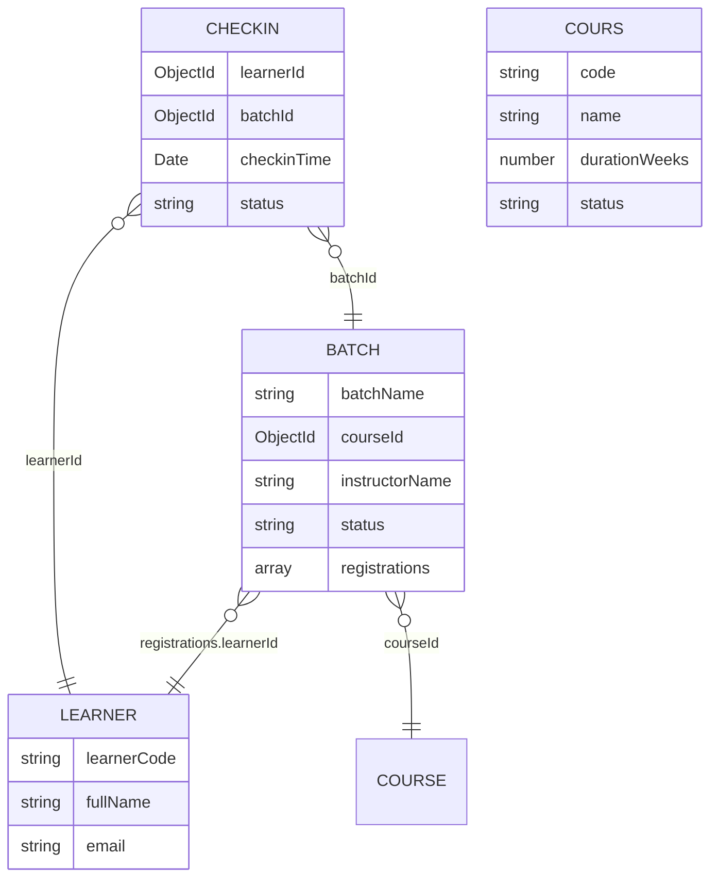

# BAN DO LIEN KET DU LIEU & KIEN TRUC HE THONG (SDN302)

> File nay duoc tu dong phan tich va sinh boi khoi-tao.js dua tren du lieu mau tu `D:\SEM_7\SDN302\tho\data`.

---

## 1. So do thuc the lien ket (ERD)




---

## 2. Bang ma tran quan he (Foreign Keys)

| Collection goc | Truong khoa ngoai (Field) | Tham chieu Model | Collection dich | Quan he | Ghi chu |
| :--- | :--- | :--- | :--- | :--- | :--- |
| **batches** | `courseId` | **Course** | `courses` | N - 1 | Khoa ngoai truc tiep |
| **batches** | `registrations.learnerId` | **Learner** | `learners` | N - 1 | Khoa ngoai trong Sub-document |
| **checkins** | `learnerId` | **Learner** | `learners` | N - 1 | Khoa ngoai truc tiep |
| **checkins** | `batchId` | **Batch** | `batches` | N - 1 | Khoa ngoai truc tiep |


---

## 3. Danh muc API CRUD mau

| Method | Endpoint | Controller | Route | Model |
| :---: | :--- | :--- | :--- | :--- |
| `GET` | `/api/batches` | `batch.controller.js` | `batch.route.js` | `batch.model.js` |
| `GET` | `/api/batches/:id` | `batch.controller.js` | `batch.route.js` | `batch.model.js` |
| `POST` | `/api/batches` | `batch.controller.js` | `batch.route.js` | `batch.model.js` |
| `PUT` | `/api/batches/:id` | `batch.controller.js` | `batch.route.js` | `batch.model.js` |
| `DELETE` | `/api/batches/:id` | `batch.controller.js` | `batch.route.js` | `batch.model.js` |
| `GET` | `/api/checkins` | `checkin.controller.js` | `checkin.route.js` | `checkin.model.js` |
| `GET` | `/api/checkins/:id` | `checkin.controller.js` | `checkin.route.js` | `checkin.model.js` |
| `POST` | `/api/checkins` | `checkin.controller.js` | `checkin.route.js` | `checkin.model.js` |
| `PUT` | `/api/checkins/:id` | `checkin.controller.js` | `checkin.route.js` | `checkin.model.js` |
| `DELETE` | `/api/checkins/:id` | `checkin.controller.js` | `checkin.route.js` | `checkin.model.js` |
| `GET` | `/api/courses` | `cours.controller.js` | `cours.route.js` | `cours.model.js` |
| `GET` | `/api/courses/:id` | `cours.controller.js` | `cours.route.js` | `cours.model.js` |
| `POST` | `/api/courses` | `cours.controller.js` | `cours.route.js` | `cours.model.js` |
| `PUT` | `/api/courses/:id` | `cours.controller.js` | `cours.route.js` | `cours.model.js` |
| `DELETE` | `/api/courses/:id` | `cours.controller.js` | `cours.route.js` | `cours.model.js` |
| `GET` | `/api/learners` | `learner.controller.js` | `learner.route.js` | `learner.model.js` |
| `GET` | `/api/learners/:id` | `learner.controller.js` | `learner.route.js` | `learner.model.js` |
| `POST` | `/api/learners` | `learner.controller.js` | `learner.route.js` | `learner.model.js` |
| `PUT` | `/api/learners/:id` | `learner.controller.js` | `learner.route.js` | `learner.model.js` |
| `DELETE` | `/api/learners/:id` | `learner.controller.js` | `learner.route.js` | `learner.model.js` |


---

## 4. Chi tiet cau truc tung Collection


### Collection: `batches` (Model: `Batch`)
- **So luong ban ghi mau**: 4 documents
- **API Endpoint**: `http://localhost:9999/api/batches`

| Truong (Field) | Kieu du lieu (Type) | Bat buoc (Required) | Tham chieu (Ref) |
| :--- | :--- | :---: | :--- |
| `batchName` | `string` | Co | - |
| `courseId` | `ObjectId` | Co | `ref: 'Course'` |
| `instructorName` | `string` | Co | - |
| `status` | `string` | Co | - |
| `registrations` | `array` | Co | - |

### Collection: `checkins` (Model: `Checkin`)
- **So luong ban ghi mau**: 6 documents
- **API Endpoint**: `http://localhost:9999/api/checkins`

| Truong (Field) | Kieu du lieu (Type) | Bat buoc (Required) | Tham chieu (Ref) |
| :--- | :--- | :---: | :--- |
| `learnerId` | `ObjectId` | Co | `ref: 'Learner'` |
| `batchId` | `ObjectId` | Co | `ref: 'Batch'` |
| `checkinTime` | `Date` | Co | - |
| `status` | `string` | Co | - |

### Collection: `courses` (Model: `Cours`)
- **So luong ban ghi mau**: 4 documents
- **API Endpoint**: `http://localhost:9999/api/courses`

| Truong (Field) | Kieu du lieu (Type) | Bat buoc (Required) | Tham chieu (Ref) |
| :--- | :--- | :---: | :--- |
| `code` | `string` | Co | - |
| `name` | `string` | Co | - |
| `durationWeeks` | `number` | Co | - |
| `status` | `string` | Co | - |

### Collection: `learners` (Model: `Learner`)
- **So luong ban ghi mau**: 6 documents
- **API Endpoint**: `http://localhost:9999/api/learners`

| Truong (Field) | Kieu du lieu (Type) | Bat buoc (Required) | Tham chieu (Ref) |
| :--- | :--- | :---: | :--- |
| `learnerCode` | `string` | Co | - |
| `fullName` | `string` | Co | - |
| `email` | `string` | Co | - |


---

## 5. Cu phap Mongoose tham khao

### Truy van kem Populate:
```javascript
const data = await Model.find().populate('studentId');

const data = await Class.findById(classId).populate('enrollments.studentId');

const data = await Attendance.find({ studentId }).populate({
  path: 'classId',
  populate: { path: 'subjectId' }
});
```

### Kiem tra ObjectId hop le:
```javascript
const mongoose = require('mongoose');
if (!mongoose.Types.ObjectId.isValid(id)) {
  return res.status(400).json({ error: `Invalid ID: ${id}` });
}
```
