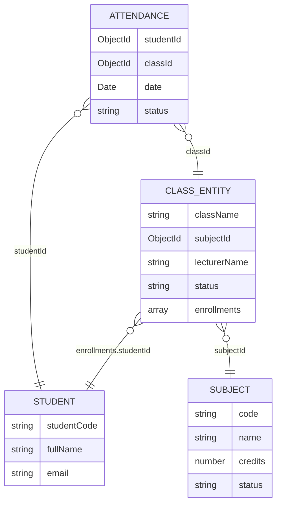

# BAN DO LIEN KET DU LIEU & KIEN TRUC HE THONG (SDN302)

> File nay duoc tu dong phan tich va sinh boi khoi-tao.js dua tren du lieu mau tu `D:\workspace\Bai_tap_tai-lieu_FPTU\Workplace-FPTU\SDN302\thi-thu\sdn-pe\z-framework-pe-SDN320-given\bai-thi\data`.

---

## 1. So do thuc the lien ket (ERD)




---

## 2. Bang ma tran quan he (Foreign Keys)

| Collection goc | Truong khoa ngoai (Field) | Tham chieu Model | Collection dich | Quan he | Ghi chu |
| :--- | :--- | :--- | :--- | :--- | :--- |
| **attendances** | `studentId` | **Student** | `students` | N - 1 | Khoa ngoai truc tiep |
| **attendances** | `classId` | **Class** | `classes` | N - 1 | Khoa ngoai truc tiep |
| **classes** | `subjectId` | **Subject** | `subjects` | N - 1 | Khoa ngoai truc tiep |
| **classes** | `enrollments.studentId` | **Student** | `students` | N - 1 | Khoa ngoai trong Sub-document |


---

## 3. Danh muc API CRUD mau

| Method | Endpoint | Controller | Route | Model |
| :---: | :--- | :--- | :--- | :--- |
| `GET` | `/api/attendances` | `attendance.controller.js` | `attendance.route.js` | `attendance.model.js` |
| `GET` | `/api/attendances/:id` | `attendance.controller.js` | `attendance.route.js` | `attendance.model.js` |
| `POST` | `/api/attendances` | `attendance.controller.js` | `attendance.route.js` | `attendance.model.js` |
| `PUT` | `/api/attendances/:id` | `attendance.controller.js` | `attendance.route.js` | `attendance.model.js` |
| `DELETE` | `/api/attendances/:id` | `attendance.controller.js` | `attendance.route.js` | `attendance.model.js` |
| `GET` | `/api/classes` | `class.controller.js` | `class.route.js` | `class.model.js` |
| `GET` | `/api/classes/:id` | `class.controller.js` | `class.route.js` | `class.model.js` |
| `POST` | `/api/classes` | `class.controller.js` | `class.route.js` | `class.model.js` |
| `PUT` | `/api/classes/:id` | `class.controller.js` | `class.route.js` | `class.model.js` |
| `DELETE` | `/api/classes/:id` | `class.controller.js` | `class.route.js` | `class.model.js` |
| `GET` | `/api/students` | `student.controller.js` | `student.route.js` | `student.model.js` |
| `GET` | `/api/students/:id` | `student.controller.js` | `student.route.js` | `student.model.js` |
| `POST` | `/api/students` | `student.controller.js` | `student.route.js` | `student.model.js` |
| `PUT` | `/api/students/:id` | `student.controller.js` | `student.route.js` | `student.model.js` |
| `DELETE` | `/api/students/:id` | `student.controller.js` | `student.route.js` | `student.model.js` |
| `GET` | `/api/subjects` | `subject.controller.js` | `subject.route.js` | `subject.model.js` |
| `GET` | `/api/subjects/:id` | `subject.controller.js` | `subject.route.js` | `subject.model.js` |
| `POST` | `/api/subjects` | `subject.controller.js` | `subject.route.js` | `subject.model.js` |
| `PUT` | `/api/subjects/:id` | `subject.controller.js` | `subject.route.js` | `subject.model.js` |
| `DELETE` | `/api/subjects/:id` | `subject.controller.js` | `subject.route.js` | `subject.model.js` |


---

## 4. Chi tiet cau truc tung Collection


### Collection: `attendances` (Model: `Attendance`)
- **So luong ban ghi mau**: 86 documents
- **API Endpoint**: `http://localhost:9999/api/attendances`

| Truong (Field) | Kieu du lieu (Type) | Bat buoc (Required) | Tham chieu (Ref) |
| :--- | :--- | :---: | :--- |
| `studentId` | `ObjectId` | Co | `ref: 'Student'` |
| `classId` | `ObjectId` | Co | `ref: 'Class'` |
| `date` | `Date` | Co | - |
| `status` | `string` | Co | - |

### Collection: `classes` (Model: `Class`)
- **So luong ban ghi mau**: 4 documents
- **API Endpoint**: `http://localhost:9999/api/classes`

| Truong (Field) | Kieu du lieu (Type) | Bat buoc (Required) | Tham chieu (Ref) |
| :--- | :--- | :---: | :--- |
| `className` | `string` | Co | - |
| `subjectId` | `ObjectId` | Co | `ref: 'Subject'` |
| `lecturerName` | `string` | Co | - |
| `status` | `string` | Co | - |
| `enrollments` | `array` | Co | - |

### Collection: `students` (Model: `Student`)
- **So luong ban ghi mau**: 6 documents
- **API Endpoint**: `http://localhost:9999/api/students`

| Truong (Field) | Kieu du lieu (Type) | Bat buoc (Required) | Tham chieu (Ref) |
| :--- | :--- | :---: | :--- |
| `studentCode` | `string` | Co | - |
| `fullName` | `string` | Co | - |
| `email` | `string` | Co | - |

### Collection: `subjects` (Model: `Subject`)
- **So luong ban ghi mau**: 4 documents
- **API Endpoint**: `http://localhost:9999/api/subjects`

| Truong (Field) | Kieu du lieu (Type) | Bat buoc (Required) | Tham chieu (Ref) |
| :--- | :--- | :---: | :--- |
| `code` | `string` | Co | - |
| `name` | `string` | Co | - |
| `credits` | `number` | Co | - |
| `status` | `string` | Co | - |


---

## 5. Cu phap Mongoose tham khao

### Truy van kem Populate:
```javascript
const data = await Model.find().populate('studentId');

const data = await Class.findById(classId).populate('enrollments.studentId');

const data = await Attendance.find({ studentId }).populate({
  path: 'classId',
  populate: { path: 'subjectId' }
});
```

### Kiem tra ObjectId hop le:
```javascript
const mongoose = require('mongoose');
if (!mongoose.Types.ObjectId.isValid(id)) {
  return res.status(400).json({ error: `Invalid ID: ${id}` });
}
```
