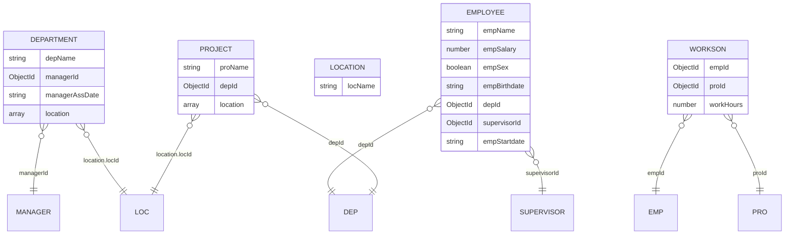

# BAN DO LIEN KET DU LIEU & KIEN TRUC HE THONG (SDN302)

> File nay duoc tu dong phan tich va sinh boi khoi-tao.js dua tren du lieu mau tu `D:\workspace\Bai_tap_tai-lieu_FPTU\Workplace-FPTU\SDN302\thi-thu\sdn-pe\z-framework-pe-SDN320-given\test\material_0`.

---

## 1. So do thuc the lien ket (ERD)




---

## 2. Bang ma tran quan he (Foreign Keys)

| Collection goc | Truong khoa ngoai (Field) | Tham chieu Model | Collection dich | Quan he | Ghi chu |
| :--- | :--- | :--- | :--- | :--- | :--- |
| **departments** | `managerId` | **Manager** | `managers` | N - 1 | Khoa ngoai truc tiep |
| **departments** | `location.locId` | **Loc** | `locs` | N - 1 | Khoa ngoai trong Sub-document |
| **employees** | `depId` | **Dep** | `deps` | N - 1 | Khoa ngoai truc tiep |
| **employees** | `supervisorId` | **Supervisor** | `supervisors` | N - 1 | Khoa ngoai truc tiep |
| **projects** | `depId` | **Dep** | `deps` | N - 1 | Khoa ngoai truc tiep |
| **projects** | `location.locId` | **Loc** | `locs` | N - 1 | Khoa ngoai trong Sub-document |
| **worksons** | `empId` | **Emp** | `emps` | N - 1 | Khoa ngoai truc tiep |
| **worksons** | `proId` | **Pro** | `pros` | N - 1 | Khoa ngoai truc tiep |


---

## 3. Danh muc API CRUD mau

| Method | Endpoint | Controller | Route | Model |
| :---: | :--- | :--- | :--- | :--- |
| `GET` | `/api/departments` | `department.controller.js` | `department.route.js` | `department.model.js` |
| `GET` | `/api/departments/:id` | `department.controller.js` | `department.route.js` | `department.model.js` |
| `POST` | `/api/departments` | `department.controller.js` | `department.route.js` | `department.model.js` |
| `PUT` | `/api/departments/:id` | `department.controller.js` | `department.route.js` | `department.model.js` |
| `DELETE` | `/api/departments/:id` | `department.controller.js` | `department.route.js` | `department.model.js` |
| `GET` | `/api/employees` | `employee.controller.js` | `employee.route.js` | `employee.model.js` |
| `GET` | `/api/employees/:id` | `employee.controller.js` | `employee.route.js` | `employee.model.js` |
| `POST` | `/api/employees` | `employee.controller.js` | `employee.route.js` | `employee.model.js` |
| `PUT` | `/api/employees/:id` | `employee.controller.js` | `employee.route.js` | `employee.model.js` |
| `DELETE` | `/api/employees/:id` | `employee.controller.js` | `employee.route.js` | `employee.model.js` |
| `GET` | `/api/locations` | `location.controller.js` | `location.route.js` | `location.model.js` |
| `GET` | `/api/locations/:id` | `location.controller.js` | `location.route.js` | `location.model.js` |
| `POST` | `/api/locations` | `location.controller.js` | `location.route.js` | `location.model.js` |
| `PUT` | `/api/locations/:id` | `location.controller.js` | `location.route.js` | `location.model.js` |
| `DELETE` | `/api/locations/:id` | `location.controller.js` | `location.route.js` | `location.model.js` |
| `GET` | `/api/projects` | `project.controller.js` | `project.route.js` | `project.model.js` |
| `GET` | `/api/projects/:id` | `project.controller.js` | `project.route.js` | `project.model.js` |
| `POST` | `/api/projects` | `project.controller.js` | `project.route.js` | `project.model.js` |
| `PUT` | `/api/projects/:id` | `project.controller.js` | `project.route.js` | `project.model.js` |
| `DELETE` | `/api/projects/:id` | `project.controller.js` | `project.route.js` | `project.model.js` |
| `GET` | `/api/worksons` | `workson.controller.js` | `workson.route.js` | `workson.model.js` |
| `GET` | `/api/worksons/:id` | `workson.controller.js` | `workson.route.js` | `workson.model.js` |
| `POST` | `/api/worksons` | `workson.controller.js` | `workson.route.js` | `workson.model.js` |
| `PUT` | `/api/worksons/:id` | `workson.controller.js` | `workson.route.js` | `workson.model.js` |
| `DELETE` | `/api/worksons/:id` | `workson.controller.js` | `workson.route.js` | `workson.model.js` |


---

## 4. Chi tiet cau truc tung Collection


### Collection: `departments` (Model: `Department`)
- **So luong ban ghi mau**: 3 documents
- **API Endpoint**: `http://localhost:9999/api/departments`

| Truong (Field) | Kieu du lieu (Type) | Bat buoc (Required) | Tham chieu (Ref) |
| :--- | :--- | :---: | :--- |
| `depName` | `string` | Co | - |
| `managerId` | `ObjectId` | Co | `ref: 'Manager'` |
| `managerAssDate` | `string` | Co | - |
| `location` | `array` | Co | - |

### Collection: `employees` (Model: `Employee`)
- **So luong ban ghi mau**: 7 documents
- **API Endpoint**: `http://localhost:9999/api/employees`

| Truong (Field) | Kieu du lieu (Type) | Bat buoc (Required) | Tham chieu (Ref) |
| :--- | :--- | :---: | :--- |
| `empName` | `string` | Co | - |
| `empSalary` | `number` | Co | - |
| `empSex` | `boolean` | Co | - |
| `empBirthdate` | `string` | Co | - |
| `depId` | `ObjectId` | Co | `ref: 'Dep'` |
| `supervisorId` | `ObjectId` | Co | `ref: 'Supervisor'` |
| `empStartdate` | `string` | Co | - |

### Collection: `locations` (Model: `Location`)
- **So luong ban ghi mau**: 4 documents
- **API Endpoint**: `http://localhost:9999/api/locations`

| Truong (Field) | Kieu du lieu (Type) | Bat buoc (Required) | Tham chieu (Ref) |
| :--- | :--- | :---: | :--- |
| `locName` | `string` | Co | - |

### Collection: `projects` (Model: `Project`)
- **So luong ban ghi mau**: 3 documents
- **API Endpoint**: `http://localhost:9999/api/projects`

| Truong (Field) | Kieu du lieu (Type) | Bat buoc (Required) | Tham chieu (Ref) |
| :--- | :--- | :---: | :--- |
| `proName` | `string` | Co | - |
| `depId` | `ObjectId` | Co | `ref: 'Dep'` |
| `location` | `array` | Co | - |

### Collection: `worksons` (Model: `Workson`)
- **So luong ban ghi mau**: 5 documents
- **API Endpoint**: `http://localhost:9999/api/worksons`

| Truong (Field) | Kieu du lieu (Type) | Bat buoc (Required) | Tham chieu (Ref) |
| :--- | :--- | :---: | :--- |
| `empId` | `ObjectId` | Co | `ref: 'Emp'` |
| `proId` | `ObjectId` | Co | `ref: 'Pro'` |
| `workHours` | `number` | Co | - |


---

## 5. Cu phap Mongoose tham khao

### Truy van kem Populate:
```javascript
const data = await Model.find().populate('studentId');

const data = await Class.findById(classId).populate('enrollments.studentId');

const data = await Attendance.find({ studentId }).populate({
  path: 'classId',
  populate: { path: 'subjectId' }
});
```

### Kiem tra ObjectId hop le:
```javascript
const mongoose = require('mongoose');
if (!mongoose.Types.ObjectId.isValid(id)) {
  return res.status(400).json({ error: `Invalid ID: ${id}` });
}
```
